<h3><code>bakkarranna@github ~ $ ./contributions.sh</code></h3>

  

<h3><code>bakkarranna@github ~ $ whoami</code></h3>
<table>
<tr>
<td valign="top"></td>
<td valign="top"></td>
</tr>
</table>
  

<h3><code>bakkarranna@github ~ $ cat interest.txt</code></h3>

<pre>
$ agentic systems .................. builder
$ motorsport data analytics ........ hobbyist
$ python / typescript / php / kotlin  toolbox
</pre>
  

<h3><code>bakkarranna@github ~ $ ls links/</code></h3>

  

ASCII portrait types itself in · heatmap reveals diagonally · refreshed daily by a GitHub Action that re-scrapes <code>github.com/users/Bakkarranna/contributions</code> -- no third-party stat services, no tokens.

