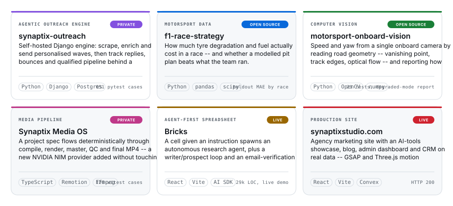

<h3><code>bakkarranna@github ~ $ ./contributions.sh</code></h3>

  

  

<h3><code>bakkarranna@github ~ $ whoami</code></h3>

  

<h3><code>bakkarranna@github ~ $ ./build_city.sh</code></h3>

  

<h3><code>bakkarranna@github ~ $ cat skills.txt</code></h3>

  

<h3><code>bakkarranna@github ~ $ ls ~/projects --featured</code></h3>

  

<h3><code>bakkarranna@github ~ $ cat interest.txt</code></h3>

<pre>
$ agentic systems .................. builder
$ motorsport data analytics ........ hobbyist
$ python / typescript / php / kotlin  toolbox
</pre>
  

<h3><code>bakkarranna@github ~ $ ls links/</code></h3>

  

<h3><code>bakkarranna@github ~ $ ./space_shooter.sh</code></h3>

  
  

a space shooter built out of one year of the contribution graph: every block is a real contribution day — its colour is that day&rsquo;s heatmap level, its health is that day&rsquo;s commit count, and the thirteen waves follow the calendar in order. No engine, no build, no trackers — just <code>space-shooter/index.html</code>, <code>game.js</code> and <code>data.js</code>.

  

the portrait prints once, as ASCII, above a neofetch-style card · heatmap reveals diagonally · the city grows back-to-front and every building answers to hover and click · meters fill on a stagger · every panel above is generated from <code>data/contributions.json</code> and <code>data/projects.json</code>, and the card&rsquo;s logo is the Synaptix mark traced into <code>data/synaptix-mark.json</code>, plus hand-authored copy by one GitHub Action that re-scrapes <code>github.com/users/Bakkarranna/contributions</code> daily — no third-party stat services, no tokens.

